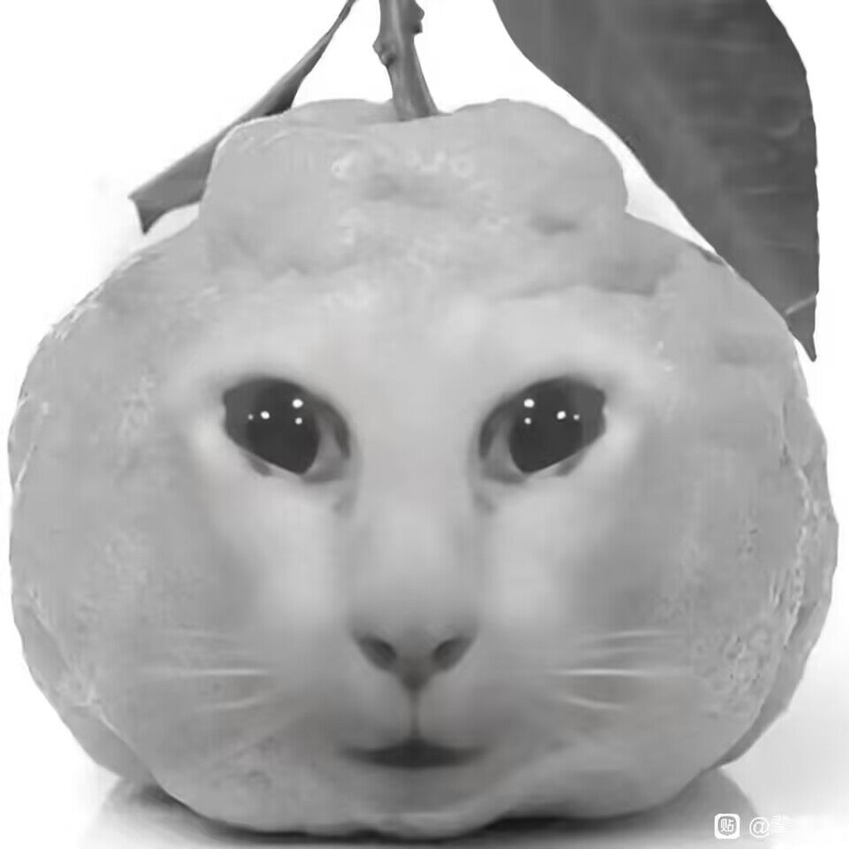

[简体中文](README.md) | **English**

---

# Tutler

Tutler is a local game, video, and image manager for Windows. It brings game executables, videos, and images scattered across your drives into a single interface, with launching, categorization, favorites, and search. All data stays on your machine and works offline.

## Features

**Game Library**
- Add games manually or recursively scan a folder to discover executables automatically
- Automatically filters out Unity crash handlers, uninstallers, redistributable installers, and other auxiliary programs
- Extracts embedded EXE icons as covers automatically, or choose a cover image manually
- Detects installed Steam games by reading `appmanifest` files and library folders, with optional automatic store cover downloads
- Tolerant search by name, path, and tags, including partial matches and minor spelling differences
- Supports launch arguments, categories, tags, notes, and favorites
- Records launch count and last-played timestamp, and keeps launch history
- Sort by recently added / name / last played / launch count

**Video and Image Libraries**
- Add any number of scan folders and recursively index common video/image formats
- Generates video thumbnails automatically when FFmpeg is installed; falls back to a placeholder otherwise
- Opens files with the system default video player / image viewer
- Custom categories and bulk assignment by folder
- Removing an entry does not delete the original file from disk

**Category Management**
- Separate category systems for games, videos, and images
- Create, delete, and reorder custom categories
- When a category is deleted, its resources fall back to the default category or uncategorized

**Interface and Interaction**
- Dark / light / follow-system themes with a customizable accent color
- Custom frameless title bar and window controls
- Responsive card grid that adjusts column count to window width
- Mutually exclusive expandable library sections in the sidebar with height animations
- Lightweight in-app notifications that do not interrupt your workflow
- Chinese / English interface (restart required after switching)

**Data Management**
- CSV import / export for game lists
- Configurable close-button behavior (ask / minimize / quit)

## Requirements

- Windows 10 / 11 (primary target platform; some features are unavailable on non-Windows systems)
- Python 3.10 or newer
- PySide6
- Optional: `psutil`
- Optional: FFmpeg (add it to `PATH` to generate video thumbnails)

## Installation and Running

1. Get the code

   git clone <repository-url>
   cd tutler

2. Create a virtual environment (recommended)

   python -m venv .venv
   .venv\Scripts\activate

3. Install dependencies

   pip install PySide6
   pip install psutil          # optional

4. Start the app

   python main.py

The app uses `tutler-logo.png` and `tutler.ico` in the same directory for its icon. If those files are missing, the interface falls back to a text mark without affecting functionality.

## Usage

### Adding Games
Click **Add Game** and enter the name and EXE path. After you select an EXE, its icon is extracted automatically as a cover preview. You can also click **Scan Directory** to choose a root folder; the app lists all candidate EXEs, and you can select and import them in bulk. Scan results may include launchers or components, so please confirm the main executable yourself.

### Detecting Steam Games
Click **Detect Steam** to automatically search the registry and common installation locations for Steam libraries, read installed games, and try to match their main executables. You can manually specify the Steam installation path under **App Settings → Steam**, and control whether covers are downloaded automatically and whether Steam detection runs at startup.

### Video / Image Libraries
Switch to the corresponding library, then click **Add Video Folder** / **Add Image Folder** and choose a folder. If you are currently viewing a custom category page, newly scanned files are automatically assigned to that category. Categories can be changed individually on each card.

### Category Management
Expand **Game Categories** in the left sidebar to add custom categories; click **Sort / Manage Game Categories** to reorder or delete custom categories. Video and image libraries each have their own management entry.

### Import and Export
Export writes the current game library to a UTF-8-BOM CSV containing name, path, launch arguments, category, tags, notes, cover, favorite, launch count, last played, Steam AppID, and install directory. Import only requires the `name` and `exe_path` columns; duplicate paths are skipped automatically.

## Data Storage Location

All data is stored in your local user directory and is never written into game installation folders:

%LOCALAPPDATA%\GameShelf\
├── gameshelf.db            # SQLite database
├── covers\                 # Cover cache (Steam covers and extracted EXE icons)
├── video_thumbnails\       # Video thumbnail cache
└── icon_extract_debug.log  # Icon extraction diagnostic log

Game files themselves are never copied, moved, or deleted. Removing an entry from the library only deletes the database record.

## Project Structure

main.py      # Main application: database, scanning, UI, themes, and business logic
i18n.py      # UI text translations
tutler-logo.png / tutler.ico  # Application icons

## Notes

- Detecting Steam games for the first time requires an internet connection to download covers; importing still works offline, but covers will be missing.
- Covers are copied into Tutler's data directory, so moving the original image does not affect display.
- Scanning large folders can take a while; scanning runs in background threads and does not block the UI.
- Frameless window edge-resizing relies on native Windows message handling; on non-Windows platforms it may behave like a normal window.

## Open Source License

This project is released under the **MIT License**.

## Contributing

Issues and pull requests are welcome. 

## Logo Origin

The Tutler icon (`tutler-logo.png` / `tutler.ico`) was produced with an AI image generation tool. It is not hand-drawn and is not third-party artwork.

The original pre-generation reference image is shown below:

> Note: the image above is the pre-generation original/reference for this project's logo, included in the repository solely to document the icon's origin. To use your own artwork instead, simply replace `tutler-logo.png` and `tutler.ico` and update the image path in this section.
